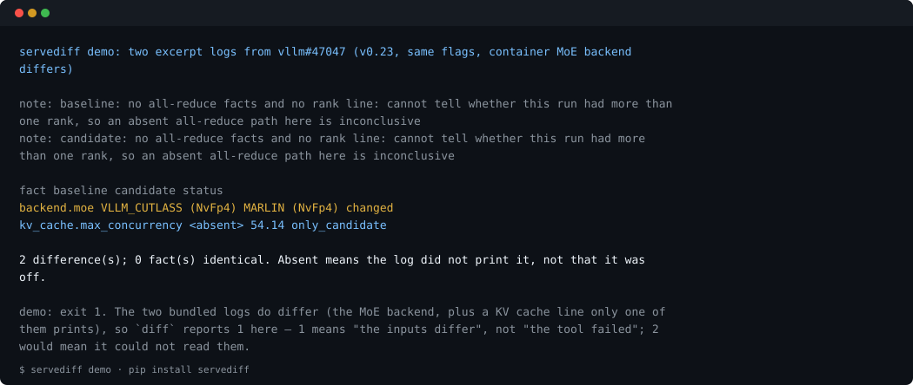

# servediff

[](https://pypi.org/project/servediff/)
[](https://pypi.org/project/servediff/)
[](https://github.com/apex-mochen/servediff/blob/main/LICENSE)
[](https://github.com/apex-mochen/servediff/actions/workflows/ci.yml)

**Same flags, different server.** `servediff` shows what your vLLM or SGLang server
*actually* ran with — and what changed between two runs.



That is `servediff demo`, run on the two logs bundled in the package: same flags, and the
container MoE backend went from `VLLM_CUTLASS` to `MARLIN`. No log of your own needed to
see it.

Benchmark result files only record the client side. After an upgrade, the server can
silently pick a different MoE or attention backend, change its CUDA graph capture,
fall back to another code path, or run against different torch / triton / flashinfer
builds. Today you find that by reading startup logs and bisecting by hand.
`servediff` does the reading for you.

- **Who it is for:** anyone comparing two vLLM / SGLang runs — after an upgrade, a flag
  change, or between machines — who needs to know *what differs on the server side*.
- **What it reads:** the server's startup log, and optionally a snapshot of the
  server's Python environment. Offline, no GPU, no dependencies.
- **What it does not do:** it does not say *which* difference caused a performance
  change. That still needs an A/B run. It tells you what to A/B.

## Why not just `diff` the two logs

Because a startup log is not a config file. `diff` compares text, and the text churns:
timestamps, pids, two paths, progress bars that redraw the same line forty times. The values
you care about sit *inside* lines whose wording also changes, so a one-line answer arrives
buried in a few thousand irrelevant ones, and a value that went `0.45` → `0.41` is invisible
while a line that merely reordered is loud. `servediff` reads each line into a named fact
(`backend.moe`, `kv_cache.tokens`, `gpu.utilization_effective`) and compares the facts, so
the diff is a table of settings — with the ones a log never printed marked `<absent>`
instead of being guessed at.


## Try it in one minute (no GPU)

```bash
pip install servediff
servediff demo
```

`demo` diffs two excerpt logs that ship inside the package, so your first command
produces real output without you finding logs first. It exits `1`, because the two
logs do differ — that is the result, not a failure.

The same pair, from the repo (the excerpt is public, from [vllm#47047](https://github.com/vllm-project/vllm/issues/47047)):

```bash
git clone https://github.com/apex-mochen/servediff && cd servediff
servediff diff examples/issue-excerpts/vllm-47047-v0.23-default.log examples/issue-excerpts/vllm-47047-v0.23-marlin.log
```

Install from PyPI. A different, unrelated tool also uses the name `servediff` in a
third-party Homebrew tap; the `pip install servediff` package is this one.

```text
note: baseline: no all-reduce facts and no rank line: cannot tell whether this run had more than one rank, so an absent all-reduce path here is inconclusive
note: candidate: no all-reduce facts and no rank line: cannot tell whether this run had more than one rank, so an absent all-reduce path here is inconclusive

fact                             baseline                                 candidate                                status
backend.moe                      VLLM_CUTLASS (NvFp4)                     MARLIN (NvFp4)                           changed
kv_cache.max_concurrency         <absent>                                 54.14                                    only_candidate

2 difference(s); 0 fact(s) identical. Absent means the log did not print it, not that it was off.
```

The two `note:` lines are part of the answer, not noise: the excerpt posted in that
issue carries no rank line, so this run cannot say whether it was multi-GPU at all,
and the tool says so instead of leaving you to read silence as "unchanged".

The `kv_cache.max_concurrency` line is the second kind of answer worth noticing: the
Marlin excerpt happened to quote the concurrency line, the other one did not, so it
shows up as present-on-one-side rather than as a backend change. Read it as "one of
these two logs tells you this, the other stays silent" — not as "the value changed".

## Recording your own two logs

Most people meet this with one log and a question, not two ready files. `capture` runs the
server, tees its output, and snapshots the environment *before* launch, so the next run is
directly comparable:

```bash
# before the upgrade, with the flags you actually use
servediff capture -o before.log -- python -m vllm.entrypoints.openai.api_server --model <model> ...
# Ctrl-C once the server is up: the startup lines are already in before.log
servediff capture -o after.log -- <the same command>
servediff diff before.log after.log                      # what the server did differently
servediff diff before.log.env.json after.log.env.json    # package, GPU and engine env drift
```

Ctrl-C stops the server, keeps the log, and exits `130`. A run that ends on its own passes the
server's exit code through, so `capture` is safe inside a script that checks it. If the command
names a python launcher, that interpreter is the one snapshotted; for entry points like
`vllm serve`, pass `--python <the server's python>`.

## Commands and exit codes

| Command | What it reads | Exit codes |
|---|---|---|
| `servediff show <log>` | one startup log (or `-` for stdin) → the facts it printed, each with its line number; `--json` | `0` read something; `2` unreadable path or no line recognised |
| `servediff diff <a> <b>` | two startup logs, or two `servediff env` snapshots; `--json`, `--markdown`, `--all`, `--raw-args`, `--skip-absent` | `0` identical; `1` at least one difference; `2` usage error, unreadable path, or one log mixed with one snapshot |
| `servediff series <a> <b> <c> ...` | three or more startup logs, in the column order you give → one fact per row; `--json`, `--markdown`, `--all`, `--raw-args` | `0` same across every log; `1` at least one fact differs; `2` fewer than three inputs |
| `servediff env [--python P] [-o snap.json]` | that interpreter's packages, GPU info, and env vars whose names start with `VLLM_` / `SGLANG_` / `SGL_` / `CUDA_` / `NCCL_` / `TORCH_` / `PYTORCH_` / `FLASHINFER_` / `TRITON_` or are `HF_HUB_OFFLINE` / `TRANSFORMERS_OFFLINE`; secret-looking names become `<redacted>` | `0` written; `2` snapshot failed |
| `servediff capture [-o run.log] -- <server command>` | runs the server, tees its log to stdout and to the file, and writes `<out>.env.json` **before** launch. If the command names a python launcher (`capture -- python -m vllm...`), that interpreter is the one snapshotted; otherwise pass `--python` to point at the server's venv | the server's own exit code |
| `servediff demo` | two excerpt logs shipped inside the package → a real diff with no log files of your own; run this first after installing | `1` always (the bundled logs differ; see the note it prints) |
| `servediff audit <log>` | the lines no rule reads, split into noise (counted) and shapes worth a look (listed); `--top N`, `--everything`, `--markdown`, `--max-shapes N` | `0` reported; `1` more shapes worth a look than `--max-shapes` allows; `2` unreadable path |

`1` always means *the inputs differ* — never *something went wrong* — so
`servediff diff old.log new.log` works directly as a CI gate. At most one input may be
`-`, because stdin can only be read once.

```yaml
# .github/workflows/startup-log.yml — fail the job when a version bump changes startup
- run: pip install servediff
- run: servediff diff old.log new.log --markdown >> "$GITHUB_STEP_SUMMARY"
  # exit 1 fails the step; the summary carries the table for whoever reads the run
```

That is the difference the reporter of
[vllm#47047](https://github.com/vllm-project/vllm/issues/47047) found by hand after a
v0.21 → v0.23 throughput drop. The example files are the log lines posted in that
issue (see [tests/fixtures/README.md](https://github.com/apex-mochen/servediff/blob/main/tests/fixtures/README.md)).

## Real example: same flags, vLLM 0.28.0 vs 0.30.0

Two startup logs from one RTX 4060 Laptop under WSL2, identical flags
(Qwen2.5-0.5B-Instruct, fp16, `--max-model-len 2048`, `--gpu-memory-utilization 0.45`):

```bash
servediff diff vllm-0.28.0.log vllm-0.30.0.log
```

```text
warning: baseline server failed to start: RuntimeError: UVA is not available; facts after the failure are absent because startup stopped, not because they were off

note: baseline: no all-reduce facts: world_size=1, so there is no all-reduce group and no backend is chosen; a TP>1 run is what makes this path observable
note: candidate: no all-reduce facts: world_size=1, so there is no all-reduce group and no backend is chosen; a TP>1 run is what makes this path observable

fact                             baseline                                 candidate                                status
backend.attention                <absent>                                 FLASH_ATTN                               only_candidate
backend.flash_attn_version       <absent>                                 2                                        only_candidate
backend.sampling_flashinfer      <absent>                                 disabled                                 only_candidate
compile.artifacts                <absent>                                 25 entries, 3 artifacts, 4996920 bytes   only_candidate
compile.autotune_gemm            <absent>                                 disabled (not enough SMs)                only_candidate
compile.dynamo_s                 <absent>                                 9.43                                     only_candidate
compile.graph_s                  <absent>                                 13.12                                    only_candidate
compile.range                    <absent>                                 1,2048                                   only_candidate
compile.total_s                  <absent>                                 31.08                                    only_candidate
compile.warmup_s                 <absent>                                 1.02                                     only_candidate
cpu.torch_threads                <absent>                                 16 -> 1                                  only_candidate
cuda_graph.capture_gib           <absent>                                 [0.25, 0.17]                             only_candidate
cuda_graph.capture_s             <absent>                                 [9, 11]                                  only_candidate
cuda_graph.captures              <absent>                                 ["PIECEWISE x51", "FULL x2", "FULL x35"] only_candidate
cuda_graph.pool_gib              <absent>                                 0.17                                     only_candidate
cuda_graph.profiling             <absent>                                 enabled (default since v0.21.0)          only_candidate
engine.init_s                    <absent>                                 109.17                                   only_candidate
engine.version                   0.28.0                                   0.30.0                                   changed
gpu.budget_gib                   <absent>                                 3.6                                      only_candidate
gpu.free_gib                     <absent>                                 6.93                                     only_candidate
gpu.total_gib                    <absent>                                 8.0                                      only_candidate
gpu.utilization                  <absent>                                 0.45                                     only_candidate
gpu.utilization_effective        <absent>                                 0.4151                                   only_candidate
gpu.utilization_to_match_kv_cache <absent>                                 0.4849                                   only_candidate
jit.monitor_mode                 <absent>                                 warn                                     only_candidate
jit.warmup_s                     <absent>                                 0.0                                      only_candidate
kernel.ir_op.gelu_and_mul_sparse <absent>                                 triton|native                            only_candidate
kv_cache.layout                  <absent>                                 LBNHC                                    only_candidate
kv_cache.max_concurrency         <absent>                                 69.3                                     only_candidate
kv_cache.memory_gib              <absent>                                 1.62                                     only_candidate
kv_cache.tokens                  <absent>                                 141936                                   only_candidate
model_loading.gib                <absent>                                 0.93                                     only_candidate
model_loading.seconds            <absent>                                 19.122619                                only_candidate
parallel.roles                   DP rank 0, PP rank 0, PCP rank 0, TP ... DP rank 0, PP rank 0, PCP rank 0, TP ... changed
sampling.overridden              <absent>                                 {'repetition_penalty': 1.1, 'temperat... only_candidate
server.bind                      <absent>                                 http://0.0.0.0:8031                      only_candidate
server.scale_out                 <absent>                                 disabled                                 only_candidate
server.tasks                     <absent>                                 ['generate']                             only_candidate
serving.chat_template_content_format <absent>                                 string                                   only_candidate
startup                          failed                                   ready                                    changed
startup.error                    ["RuntimeError: UVA is not available"... <absent>                                 only_baseline
uva_buffers                      <absent>                                 fallback: device memory                  only_candidate
weights.available_ram_gib        <absent>                                 4.23                                     only_candidate
weights.cache                    <absent>                                 miss (from scratch)                      only_candidate
weights.checkpoint_gib           <absent>                                 0.92                                     only_candidate
weights.filesystem               <absent>                                 EXT4                                     only_candidate
weights.load_s                   <absent>                                 10.49                                    only_candidate
weights.prefetch                 <absent>                                 disabled (EXT4 is not a network FS)      only_candidate

48 difference(s); 13 fact(s) identical. Absent means the log did not print it, not that it was off.
```

0.28.0 does not start on WSL2 with default settings; 0.30.0 does, because it falls
back to device memory when pinned memory is unavailable. Upstream fixed this in
[vllm#56908](https://github.com/vllm-project/vllm/pull/56908), first released in
v0.30.0. Forcing the V1 model runner on 0.28.0 (`VLLM_USE_V2_MODEL_RUNNER=0`) makes it
start, and the remaining server-side differences are:

```text
note: baseline: no all-reduce facts: world_size=1, so there is no all-reduce group and no backend is chosen; a TP>1 run is what makes this path observable
note: candidate: no all-reduce facts: world_size=1, so there is no all-reduce group and no backend is chosen; a TP>1 run is what makes this path observable

fact                             baseline                                 candidate                                status
compile.artifacts                25 entries, 3 artifacts, 4997798 bytes   25 entries, 3 artifacts, 4996920 bytes   changed
compile.dynamo_s                 8.29                                     9.43                                     changed
compile.graph_s                  16.92                                    13.12                                    changed
compile.total_s                  32.58                                    31.08                                    changed
compile.warmup_s                 2.66                                     1.02                                     changed
cuda_graph.capture_gib           0.36                                     [0.25, 0.17]                             changed
cuda_graph.capture_s             12                                       [9, 11]                                  changed
cuda_graph.captures              ["mixed prefill-decode, PIECEWISE x51... ["PIECEWISE x51", "FULL x2", "FULL x35"] changed
cuda_graph.pool_gib              0.36                                     0.17                                     changed
engine.init_s                    74.0                                     109.17                                   changed
engine.version                   0.28.0                                   0.30.0                                   changed
gpu.utilization_effective        0.4031                                   0.4151                                   changed
gpu.utilization_to_match_kv_cache 0.4969                                   0.4849                                   changed
jit.warmup_s                     <absent>                                 0.0                                      only_candidate
kernel.ir_op.gelu_and_mul_sparse <absent>                                 triton|native                            only_candidate
kv_cache.layout                  <absent>                                 LBNHC                                    only_candidate
kv_cache.max_concurrency         60.52                                    69.3                                     changed
kv_cache.memory_gib              1.42                                     1.62                                     changed
kv_cache.tokens                  123952                                   141936                                   changed
model_loading.seconds            13.191946                                19.122619                                changed
model_runner                     V1                                       V2                                       changed
parallel.roles                   DP rank 0, PP rank 0, PCP rank 0, TP ... DP rank 0, PP rank 0, PCP rank 0, TP ... changed
server.scale_out                 <absent>                                 disabled                                 only_candidate
uva_buffers                      <absent>                                 fallback: device memory                  only_candidate
weights.available_ram_gib        4.94                                     4.23                                     changed
weights.cache                    <absent>                                 miss (from scratch)                      only_candidate
weights.load_s                   7.86                                     10.49                                    changed

27 difference(s); 33 fact(s) identical. Absent means the log did not print it, not that it was off.
```

Rows of that kind are the reason this exists, and none of them shows up in a bug report.
`compile.autotune_gemm` and `kernel.ir_op.gelu_and_mul_sparse` show a faster kernel path
being skipped or a different kernel being chosen with no argument changed;
`sampling.overridden` shows the model's `generation_config.json` overriding the flags,
which is why two "identical" launches can sample differently. `gpu.free_gib` versus
`gpu.budget_gib` is the headroom an OOM is later judged against. `gpu.utilization_effective`
is the utilization a run *actually* spends once CUDA graph memory profiling takes its
share — the line also prints the value needed to keep the old KV cache, so a version that
changed only that default is visible here instead of as an unexplained capacity loss.
`weights.prefetch` is the same story on the loading side: the loader skips prefetch on a
filesystem it does not recognise as a network FS, and startup time changes with it.

## When one of the two runs died

The most common real pair is a run that crashed against the same flags that now work. The
crash stops the log early, so every fact printed after it is `<absent>` on one side — on the
0.28.0-vs-0.30.0 pair that is 45 of the 48 rows, and they bury the three that explain the
outcome. `--skip-absent` keeps only the facts both logs printed, i.e. what changed on the
same code path, and says how many it hid instead of quietly recounting them as identical:

```text
$ servediff diff vllm-0.28.0.log vllm-0.30.0.log --skip-absent
warning: baseline server failed to start: RuntimeError: UVA is not available; facts after the failure are absent because startup stopped, not because they were off

note: 45 difference(s) hidden by --skip-absent: one side never printed those lines, so they can only be listed, not compared

fact                             baseline                                 candidate                                status
engine.version                   0.28.0                                   0.30.0                                   changed
parallel.roles                   DP rank 0, PP rank 0, PCP rank 0, TP ... DP rank 0, PP rank 0, PCP rank 0, TP ... changed
startup                          failed                                   ready                                    changed

3 difference(s); 13 fact(s) identical. 45 difference(s) skipped because one side never printed those lines (--skip-absent). Absent means the log did not print it, not that it was off.
```

The exit code is still 1: the inputs do differ. `--json` reports both counts
(`differences` including the hidden ones, and `compared_both_sides` without them), so a
script cannot mistake a smaller table for a cleaner result.

## Validated against real TP>1 logs

The parallel-config rules were written and checked against a real TP=8 startup log
posted in [vllm#48591](https://github.com/vllm-project/vllm/issues/48591) (v0.23.1,
8 workers, one `world_size=N` line per rank, role assignment without an ETP field):

```text
parallel.world_size              8
parallel.roles                   DP rank 0, PP rank 0, PCP rank 0, TP rank 0, EP rank N/A, EPLB rank N/A
compile.fusions                  allreduce_rms
startup                          failed
```

### When the all-reduce path changes silently

vLLM chooses an all-reduce implementation per TP group out of a candidate list, and
FlashInfer can pick its own backend on top of that. These lines are printed once at
startup and never mentioned again — which is how a version bump can move decode
through a different communication path without any flag changing. Since 0.3.7 they
are facts (this is `servediff show` on the same v0.23.1 TP=8 log):

```text
backend.allreduce_dispatch       tp:0: ['CUSTOM', 'SYMM_MEM', 'PYNCCL']                       line 37
backend.allreduce_flashinfer     mnnvl                                                        line 102
backend.allreduce_fusion         ["norm: mnnvl", "norm quantization: trtllm"]                 line 106
backend.allreduce_potential      ['NCCL_SYMM_MEM', 'QUICK_REDUCE', 'FLASHINFER', 'AITER_CU... line 37
model_runner                     V2                                                           line 39
```

The first two separate *chosen* from *possible*: FlashInfer sitting in `potential`
but not in `dispatch` means it was not used for that group. The last two record
whether FlashInfer's fused workspaces were actually built, but read their absence
carefully: since 0.29.0 the FlashInfer auto-selection line is logged at DEBUG
(`debug_once`), so on a default INFO log it may simply not have been printed. The
`all-reduce backends (in dispatch order)` line is `info_once` in 0.29.0, which makes
the dispatch chain the reliable cross-version signal. `model_runner` covers V1 vs V2
(so `VLLM_USE_V2_MODEL_RUNNER=0` runs are identifiable), and `compile.fusions` carries
`allreduce_rms` when `fuse_allreduce_rms` is on.

A fact missing from *both* logs leaves no diff row at all, so it would otherwise be
counted as "identical" without ever being compared. Since 0.3.8 `diff` names the reason
where it can tell, instead of leaving that to the reader:

```text
> ℹ️ baseline: no all-reduce facts: world_size=1, so there is no all-reduce group and
  no backend is chosen; a TP>1 run is what makes this path observable
```

That note is what separates *nothing changed* from *nothing could be seen*: on a TP=1
log the all-reduce path does not exist to compare, and a TP>1 log that begins after
engine init never printed the selection. The same mechanism flags a 0.29+ log whose
FlashInfer fact is missing because the line is DEBUG-only.

That makes the question raised in
[vllm#63705](https://github.com/vllm-project/vllm/issues/63705) — *did 0.29 turn
FlashInfer all-reduce on by default (#52998)?* — answerable from logs you already
keep, one per version, same TP:

```bash
servediff diff v0.28.log v0.29.log
```

On a real 4×H100 TP4+EP node (MiniMax-M2.7, one run per version) that is exactly what
the diff showed between v0.26.0 and v0.29.0: the TP group chain went from `['PYNCCL']`
to `['FLASHINFER', 'PYNCCL']` while the EP group stayed `['PYNCCL']`, V2 Model Runner
appeared, and `allreduce_rms` was off in both runs — so the two changed defaults are
the TP-side FlashInfer path and the model runner ([reported
here](https://github.com/vllm-project/vllm/issues/63705#issuecomment-6656162111)).

So a TP4+EP comparison (like the one in the
[#63705 analysis](https://github.com/apex-mochen/servediff/blob/main/ISSUE-63705-analysis.md)
— a decode-only regression across vLLM 0.29–0.32) can be scripted as:

```bash
servediff capture -o v026.log -- docker run ... vllm/vllm-openai:v0.26.0 ...
servediff capture -o v029.log -- docker run ... vllm/vllm-openai:v0.29.0 ...
servediff diff v026.log v029.log --markdown
```

## Dependency versions: `servediff env`

Logs do not print torch / triton / flashinfer versions, and upgrades of those change
server behaviour too. Snapshot each server environment with its own interpreter —
nothing needs to be installed into it:

```bash
servediff env --python /path/to/old-venv/bin/python -o old.json
servediff env --python /path/to/new-venv/bin/python -o new.json
servediff diff old.json new.json
```

Excerpt from those two environments (20 inference-relevant rows; the rest of the package
list is hidden unless you pass `--all`):

```text
pkg.flashinfer-python            0.6.16.post3                             0.6.18.post1                             changed
pkg.nvidia-cuda-nvcc             13.3.73                                  13.0.88                                  changed
pkg.nvidia-cutlass-dsl           4.6.2                                    4.7.1                                    changed
pkg.torch                        2.13.0                                   2.13.0+cu130                             changed
pkg.transformers                 5.16.1                                   5.17.0                                   changed
pkg.vllm                         0.28.0                                   0.30.0                                   changed
```

Note the older vLLM environment carries *newer* CUDA toolkit wheels (13.3 vs 13.0).
Whether that matters for performance is not known — that is what an A/B run is for.
Versions are read from package metadata, so the same torch build can show as `2.13.0`
in one environment and `2.13.0+cu130` in another.

The snapshot records Python, GPU name and driver (via `nvidia-smi`), all installed
package versions, and env vars starting with `VLLM_`, `SGLANG_`, `SGL_`, `CUDA_`,
`NCCL_`, `TORCH_`, `PYTORCH_`, `FLASHINFER_`, `TRITON_`. Values of variables whose name
contains `TOKEN`, `KEY`, `SECRET`, `PASSWORD`, `CREDENTIAL` or `AUTH` are replaced with
`<redacted>`. Snapshots and logs contain local paths: review them before sharing.

## What it extracts

| Fact | vLLM | SGLang |
|---|---|---|
| version | banner / engine init | — (not printed) |
| arguments | `non-default args` | `server_args` (all args) |
| attention backend | `Using X attention backend`; and the backend actually chosen after the check, `Using AttentionBackendEnum.FLASHINFER backend.` — a flag asks for one, this line says which won | `attention_backend` arg |
| MoE backend | three log formats seen in 0.23–0.30, plus the full candidate list when the build prints it separately | `moe_runner_backend` arg |
| CUDA graph | eager mode, `cudagraph_mode`, capture sets, capture time and memory, pool size | prefill CUDA graph disabled |
| model runner, UVA fallback | `Using V2 Model Runner`; V1 runner detected via `gpu_model_runner.py` module; pinned-memory fallback | — |
| all-reduce path | chosen chain per TP group + candidate pool (`all-reduce backends (in dispatch order) … out of potential backends`), FlashInfer's auto-selected backend and its norm / norm-quantization fusion workspaces (0.3.7+) | — |
| parallel config | `world_size`, DP/PP/PCP/TP/ETP/EP/EPLB role assignment | — |
| KV cache layout | `Using LBNHC KV cache layout` (0.30+) | `KV Cache is allocated. dtype: …` |
| KV cache capacity | `Available KV cache memory: … GiB`, `GPU KV cache size: … tokens`, `Maximum concurrency for … tokens per request: …x` | — |
| model identity | `Resolved architecture: …`, `Using max model len …` — the values the engine settled on, which can differ from the requested args | — |
| engine init cost | `init engine (profile, create kv cache, warmup model) took … s` | — |
| compile cost, split | `torch.compile took … s` and its parts: `Dynamo bytecode transform time: … s`, `Compiling a graph for compile range (1, 2048) takes … s` (with the range as its own fact), `Initial profiling/warmup run took … s` — one total cannot say which of the three moved | — |
| CPU threads for serving | `Reducing Torch threads from 16 to 1 for serving`, `Reducing Torch parallelism from 96 threads to 1` — the pair, because `1` alone cannot say what it was cut from; plus the forced worker start method (`We must use the spawn multiprocessing start method`) | — |
| batching and scheduling | `Chunked prefill is enabled with max_num_batched_tokens=16384.`, `Asynchronous scheduling is enabled.` — these decide the shape of every forward pass without appearing in the flags | — |
| speculative decoding | `Using Eagle3 auxiliary layers from config: (2, 10, 18, 26, 34)` | — |
| kernel errors and picks | `CUDA error (…flash_api.cpp): invalid configuration argument` (degraded, not fatal), `Using FlashInfer for top-p & top-k sampling.`, `FlashInfer resolved query dtypes: …`, `vLLM is using nccl==…` | — |
| loading cost, split | `Loading model from scratch`, `Initializing model took … s`, `Loading weights took … s`, `Model loading took … GiB memory and … seconds` — so a slower startup names its step | — |
| weight source | `Filesystem type for checkpoints: … Checkpoint size: … Available RAM: …`, `Auto-prefetch is …` (prefetch is skipped on a filesystem the loader does not treat as a network FS) | — |
| GPU memory headroom | free / total at startup, desired utilization, budgeted GiB, plus `CUDA graph memory profiling` mode and the effective utilization it leaves (`equivalent to --gpu-memory-utilization=…`, `increase … to …` to keep the old KV cache) | — |
| server surface | `Supported tasks: …`, `Scale-out endpoints are …`, chat template content format, FlashInfer autotune skipped, listening address | — |
| server command | — (not printed) | `sgl start command: …` (the exact invocation, defaults included) |
| kernel selection | one fact per op from `Final IR op priority …`, e.g. `kernel.ir_op.rms_norm=native`; the autotune gate from `Not enough SMs to use max_autotune_gemm mode` | — |
| sampler defaults | `Default vLLM sampling parameters have been overridden by the model's generation_config.json` | — |
| JIT behaviour | `JIT kernel warmup finished in … s`, `monitored JIT compilations … mode=` | — |
| torch.compile | `collected artifacts: …`, `torch.compile took … s in total` | — |
| startup outcome | ready / failed + root-cause error | ready / failed + root-cause error |

Every fact keeps the log line it came from (`servediff show <log>` or `--json`).
A fact the log did not print is `<absent>`: servediff never fills in defaults.
Options shared by both engines (dtype, context length, memory fraction, prefix cache,
CUDA graph, TP size) are mapped to common names, so a vLLM log and an SGLang log can be
compared, though the result is noisier than a same-engine diff.

### Pasting a report into a GitHub issue

```bash
servediff diff old.log new.log --markdown
```

Renders a GitHub-flavored table with a collapsible **Evidence** section quoting the
exact log line behind each fact — ready to paste into a regression report.

### Reading a log without copying it down

Logs usually live on the box that ran the server. `-` reads stdin, so nothing has
to be scp'd first:

```bash
ssh gpu-node 'cat /path/to/serve.log' | servediff show -
ssh gpu-node 'cat /path/to/serve.log' | servediff diff v0.31.log -
```

Only one side can be `-` (stdin is read once), and `--markdown` labels it `stdin`
in the report header.

### Three versions at once

Regression threads rarely have two runs. `series` puts every run in its own column,
so the middle version is not lost between two pairwise diffs:

```bash
servediff series v0.23.log v0.26.log v0.26-flag.log --markdown
```

```text
| fact         | v0.23.log                          | v0.26.log                     | v0.26-flag.log    |
|---|---|---|---|
| `backend.moe` | `FlashInfer CUTLASS (Unquantized)` | `TrtLlmBf16ExpertsMonolithic` | `FlashInferExperts` |
```

`--all` adds the rows that hold the same value across every log; exit codes match
`diff` (`0` identical, `1` differences, `2` nothing recognised).

### Capturing a run in one step

```bash
servediff capture -o run1.log --python /path/to/server/bin/python -- vllm serve <model>
```

Runs the server command, tees stdout+stderr to `run1.log`, and snapshots the
environment to `run1.log.env.json` before the server starts. After two runs:

```bash
servediff diff run1.log run2.log
servediff diff run1.log.env.json run2.log.env.json
```

Exit codes: `0` no differences, `1` differences, `2` nothing recognised.

## Limits

- **Tested on:** log excerpts posted in vllm#47047 (v0.23) and vllm#53472 (v0.23, v0.26);
  full startup logs of vLLM 0.28.0 and 0.30.0 (single GPU, WSL2); a real TP=8 startup log
  from vllm#48591 (v0.23.1, one line per worker + role assignment); a TP4+EP excerpt from
  a 4×H200 node in vllm#45604 (v0.29.0, two all-reduce groups); a SGLang startup log from
  sgl-project/sglang#4862 (v0.4.4, TP=4, Qwen2.5-Omni-7B — the `server_args=ServerArgs(...)`
  keyword-call form is parsed, startup failure + root-cause error recorded). One log is a
  live server run rather than an excerpt: vLLM 0.33.0 on a single RTX 4060 Laptop (8 GB)
  under WSL2, Qwen2.5-0.5B, written by `capture` — the server answered `/health` and a
  completion, Ctrl-C exited `130` and kept the log, and the two env snapshots of that run
  diff down to the two variables that separated a crash from a start. The parallel-config
  and all-reduce rules are checked against real TP>1 logs; MoE models in
  full logs, SGLang versions other than 0.4.4 and other engines are not yet verified.
- Parsing is regex-based on log text, which changes between versions. A missed line
  shows up as `<absent>`, never as a wrong value — please report it. Run
  `servediff audit run1.log` first: it prints the lines no rule reads yet, and that
  report is the useful half of a bug report. On a real 170-line vLLM startup log that
  is 64 unread lines, all of them noise (the route table, banner art, deprecation
  warnings, progress bars, access logs) — the report counts the noise and, when something
  is worth a look, lists only that second group, so what you paste is short. On that log
  nothing is left worth a look, and a test holds it that way: the day a version prints a
  configuration line this parser does not read, the suite fails and names the shape.
  A log that died is the other common case, and its report had the same problem for a
  different reason: every frame of the traceback is a line no rule reads, so a 151-line
  crashed startup came back as 146 "shapes worth a look". The noise classifier now matches
  the message after stripping the `(EngineCore pid=…) ERROR … [core.py:…]` preamble, so
  frames, carets, `[shutdown]` chatter and logging-error dumps are counted as noise and
  that log reports **1** — the `Casting torch.bfloat16 to torch.float32` warning, which
  really is a setting the parser does not read yet.
  `servediff audit --markdown run1.log` wraps it in a code fence sized around any
  backticks inside, so it can go straight into the issue form's third field.
  `servediff audit --max-shapes 20 run1.log` exits `1` when more than 20 shapes need a
  look — put that in a pipeline against a log from your own upgrade and the build fails
  when the server starts printing configuration this tool still cannot read, which is the
  moment you want to know rather than three regressions later.
- One worked example end to end: [writeups/wsl-uva-028-vs-030.md](writeups/wsl-uva-028-vs-030.md)
  — same flags on a laptop GPU under WSL2, 0.28.0 dies with `RuntimeError: UVA is not
  available`, 0.30.0 starts; the startup-log diff is 48 differences and 13 identical facts,
  and the one line that explains it is the pinned-memory fallback from vllm#56908.

## License

Apache-2.0.
