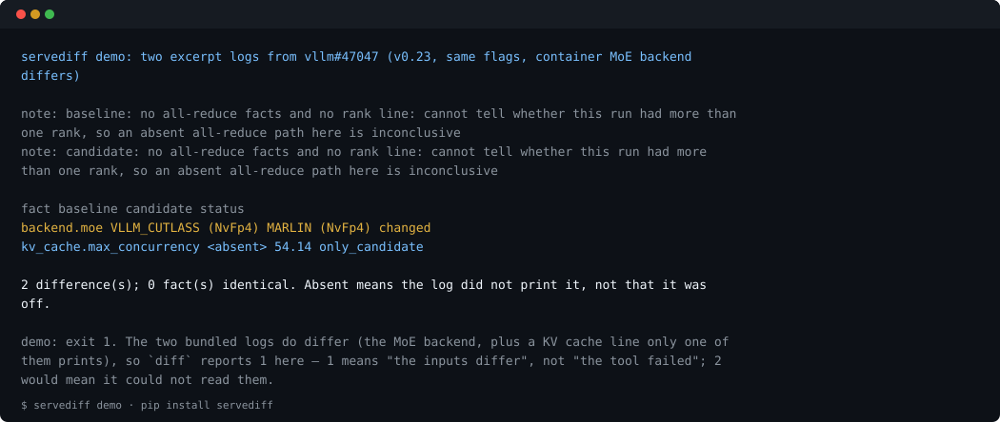

# servediff（中文说明）

**参数一样，server 却不一样。** `servediff` 告诉你 vLLM / SGLang server **实际**用了什么配置，以及两次运行之间哪里变了。



上面就是 `servediff demo` 在包内自带两份日志上的真实输出：参数相同，container 的 MoE backend 从 `VLLM_CUTLASS` 变成了 `MARLIN`。不需要你手上有任何日志就能看到。

benchmark 结果文件只记录客户端。升级之后，server 可能会悄悄换掉 MoE 或 attention backend、改变 CUDA graph 的捕获方式、走另一条回退路径，或者底下的 torch / triton / flashinfer 版本已经不同。现在要发现这些，只能人工读启动日志、逐个 bisect。servediff 替你把日志读一遍。

- **适合谁**：比较两次 vLLM / SGLang 运行的人，比如升级前后、改了某个参数、换了机器。
- **读什么**：server 的启动日志；也可以读一份 server Python 环境的快照。离线运行，不需要 GPU，没有任何依赖。
- **不做什么**：不判断性能变化是哪一项造成的，那仍然需要 A/B 实验。它告诉你该 A/B 哪几项。

## 一分钟试用（不需要 GPU）

```bash
pip install servediff
servediff demo
```

`demo` 直接 diff 包内自带的两份摘录日志，不需要你先找到日志。它返回 `1`，因为这两份日志确实有差异 —— 那是结果，不是失败。

同一对日志，从仓库里跑：

```bash
git clone https://github.com/apex-mochen/servediff && cd servediff
pip install .
servediff diff examples/issue-excerpts/vllm-47047-v0.23-default.log examples/issue-excerpts/vllm-47047-v0.23-marlin.log
```

差异落在 MoE backend：从 `VLLM_CUTLASS (NvFp4)` 变为 `MARLIN (NvFp4)`。这正是 [vllm#47047](https://github.com/vllm-project/vllm/issues/47047) 的报告者在 v0.21 → v0.23 吞吐下降后，靠人工找出来的差异。

这个项目所依赖的那个测量结果——二十份从公开 bug 报告里粘下来的日志，没有一行是解析器读不了的——在仓库里是一条命令，每份日志一行结论：

```bash
servediff audit tests/fixtures      # 给目录就审计里面所有 *.log
```


前面还会打印两行 `note:`：这份摘录里没有 rank 行，工具无法判断它是不是多卡运行，所以它直接说明「此处无法判定」，而不是让你把沉默读成「没变」。这是输出的一部分，不是噪声。

从 PyPI 安装（`pip install servediff`）。另有一个同名但无关的工具放在第三方 Homebrew tap 里，`pip` 装到的这个才是本项目。

## 采自己的两份日志

多数人手里只有一份日志和一个疑问，而不是现成的两个文件。`capture` 会跑起 server、把输出同时
转存，并在启动**之前**拍下环境快照，于是下一次运行天然可对比：

```bash
# 升级前，用你实际在用的参数
servediff capture -o before.log -- python -m vllm.entrypoints.openai.api_server --model <model> ...
# server 起来之后按 Ctrl-C：启动阶段的日志已经写进 before.log 了
servediff capture -o after.log -- <同一条命令>
servediff diff before.log after.log                      # server 到底哪里不一样
servediff diff before.log.env.json after.log.env.json    # 包、GPU 与环境变量漂移
```

Ctrl-C 会停掉 server、保留日志、退出码 `130`；server 自己结束时则透传它的退出码，所以放在
检查退出码的脚本里是安全的。命令里带 python 启动器时，快照的就是那个解释器；像 `vllm serve`
这种入口脚本，用 `--python <server 的 python>` 指明。

## 子命令与退出码

| 子命令 | 读什么 | 退出码 |
|---|---|---|
| `servediff show <log>` | 一份启动日志（`-` 表示读 stdin），输出它打印出来的每条 fact 及其行号；`--json` | `0` 读到了；`2` 路径读不了，或一行都认不出来 |
| `servediff diff <a> <b>` | 两份启动日志，或两份 `servediff env` 快照；`--json` / `--markdown` / `--all` / `--raw-args` / `--skip-absent` | `0` 一致；`1` 至少有一处不同；`2` 用法错误、路径读不了，或一份日志配一份快照 |
| `servediff series <a> <b> <c> ...` | 三份及以上日志，按你给的顺序排列成列，每条 fact 一行；`--json` / `--markdown` / `--all` / `--raw-args` | `0` 各份全同；`1` 有 fact 不同；`2` 少于三份 |
| `servediff env [--python P] [-o snap.json]` | 该解释器的包、GPU 信息，以及名字以 `VLLM_` / `SGLANG_` / `SGL_` / `CUDA_` / `NCCL_` / `TORCH_` / `PYTORCH_` / `FLASHINFER_` / `TRITON_` 开头的环境变量和 `HF_HUB_OFFLINE` / `TRANSFORMERS_OFFLINE`；看起来像密钥的名字一律写成 `<redacted>` | `0` 已写出；`2` 快照失败 |
| `servediff capture [-o run.log] -- <启动命令>` | 跑起 server、把日志同时输出到终端和文件，并在启动**之前**写出 `<out>.env.json`。命令里自带 python 启动器时（`capture -- python -m vllm...`），快照的就是那个解释器；否则用 `--python` 指到 server 所在的环境 | server 自己的退出码 |
| `servediff demo` | 用包内自带的 vllm#47047 摘录跑一次 diff，不需要任何现成日志 | `1`（这两份日志确实有差异，那是结果） |
| `servediff audit <log|dir>...` | 列出没有任何规则读到的行，分成噪声（只报数量）和「值得看一眼」的形状（逐条列出）；给目录（或给多个路径）时按一个语料整体跑，每份日志一行结论；`--top N` / `--everything` / `--markdown` / `--max-shapes N` | `0` 已读；`1` 值得看一眼的形状超过 `--max-shapes`；`2` 读不了，或 `-` 用了不止一次 |

`1` 只表示「输入不同」，不表示「出错」，所以 `servediff diff old.log new.log` 可以直接当 CI 门禁。`-` 至多出现一次：stdin 只能读一遍。

最常见的真实场景是「一次崩了、一次同样的参数能起来」。崩掉的那份日志提前结束，之后每条 fact 在它那侧都是 `<absent>`——0.28.0 对 0.30.0 这一对里 48 行差异有 45 行都是这一类，正好把解释结果的那三行埋掉。`servediff diff a.log b.log --skip-absent` 只保留两份日志都打印过的事实，也就是同一条代码路径上真正变了的东西，并明确报出它隐藏了多少行，而不是把它们悄悄算成「相同」（真实的 0.28/0.30 一对：48 差异 → 3 行 + 「45 行被隐藏」）。退出码仍是 `1`，`--json` 里 `differences` 和 `compared_both_sides` 两个数字都在。

## 真实案例：参数相同，vLLM 0.28.0 对 0.30.0

在一台 RTX 4060 Laptop（WSL2）上，两个版本用完全相同的参数启动：

- 0.28.0 默认配置**起不来**，报 `RuntimeError: UVA is not available`。
- 0.30.0 能起来，因为 pinned memory 不可用时会回退到 device memory。上游修复是 [vllm#56908](https://github.com/vllm-project/vllm/pull/56908)，v0.30.0 是第一个包含它的正式版。

servediff 会先给出"baseline 启动失败"的 warning 和根因，再列出两边的配置差异。完整输出见英文 README。

## 依赖版本：`servediff env`

```bash
servediff env --python /旧环境/bin/python -o old.json
servediff env --python /新环境/bin/python -o new.json
servediff diff old.json new.json
```

默认只显示和推理相关的包、GPU、引擎环境变量；其他包要加 `--all` 才列出。名字里含 `TOKEN`、`KEY`、`SECRET`、`PASSWORD` 等的环境变量，值一律替换成 `<redacted>`。快照和日志里有本机路径，分享之前请先检查。

## 边界

- 已测试：vllm#47047、#53472 里贴出的日志片段（v0.23、v0.26）；vLLM 0.28.0 / 0.30.0 的完整启动日志（单卡、WSL2）；vllm#48591 的真实 TP=8 启动日志（v0.23.1，每个 worker 一行 + role 分配）；vllm#45604 里 4×H200 的 TP4+EP 片段（v0.29.0，两个 all-reduce group）；sglang#4862 的 SGLang 启动日志（v0.4.4、TP=4、Qwen2.5-Omni-7B，`server_args=ServerArgs(...)` 这种关键字调用形式已解析，启动失败与根因错误已记录）。其中有一份不是片段、而是真实跑出来的日志：单卡 RTX 4060 Laptop（8 GB，WSL2）上的 vLLM 0.33.0、Qwen2.5-0.5B，由 `capture` 写入——服务确实响应了 `/health` 和一个生成请求，Ctrl-C 退出 `130` 且日志保留，同一条命令的两份环境快照 diff 出来正好就是决定「起不来 / 起得来」的那两个变量。ROCm 侧也覆盖了一份：vllm#65034 里公开贴出的 `collect_env`（vLLM 0.29.1.dev、AMD Radeon AI PRO R9700、torch 2.13+rocm10.1），它的 180 行环境块现在给出的是版本事实、而不是 175 个「值得看一眼」。NVIDIA 侧和第二个引擎也补齐了：生产镜像的 `collect_env`（vllm#63505，vLLM 0.32.0、CUDA 13.0）、八卡 MI355X 的块（vllm#65611）、gVisor 下的运行（vllm#65250），改之前分别是 45 / 61 / 51 个「值得看一眼」，现在都是零；六份 SGLang 启动日志（sglang#41654、#42684、#43741、#46756、#48502、#49206）则暴露出两类漏读——包住时间的方括号，和 SGLang 自己那套 `name: value` 环境 dump。再往后是两套新机器：一台 GB200 NVL 节点（vllm#66192，aarch64、SM100）和一台 RTX PRO 6000 Blackwell（vllm#66193），改之前分别有 9 / 13 个「值得看一眼」，全是机器拓扑（InfiniBand 的 `NIC0: mlx5_0` 网格与 `NIC Legend:`），以及一个空的 `gpu.model`。并行配置与 all-reduce 规则是在真实 TP>1 日志上核对的；完整日志里的 MoE 模型、0.4.4–0.5.20 之外的 SGLang 版本、Intel GPU 与其他引擎尚未验证。
- 解析是基于日志文本的正则匹配，跨版本会变。识别不到的行显示为 `<absent>`，不会显示成错误的值；发现漏识别的行请提 issue，并附上 `servediff audit run1.log` 的输出——它把没被规则读的行分成两类：噪声（路由表、banner、deprecation、进度条、access log，只报数量）和「值得看一眼」的形状（这些才列出来）。170 行真实 vLLM 启动日志的实际结果是 64 行未读、全是噪声、「值得看一眼」的形状为零（并且有测试把这条守住：哪天某个版本打印了工具读不懂的配置行，测试就会失败并点名那个形状），要粘贴的东西很短；崩掉的那份日志是另一种常见情形，它的 traceback 每一帧都是「没有规则读的行」，所以一份 151 行的崩溃启动日志曾经报出 146 个「值得看一眼」。现在噪声判定会在剥掉 `(EngineCore pid=…) ERROR … [core.py:…]` 前缀之后再匹配消息本体，栈帧、`^^^` 标记、`[shutdown]` 日志、logging-error dump 都算噪声，原先剩下的几行也都成了事实：`Casting torch.bfloat16 to torch.float32`（`model.cast`，没有任何参数会记录这种静默的精度变化）、输出处理失败（`startup: failed (output handler)`）、已安装但导入失败的可选 kernel 库（`kernel.module_missing` / `kernel.missing_lib`）。四份全量日志现在都是 `nothing worth a look`。换一套技术栈就会失效，这一点已经用真实日志验证过：vllm#65034 里贴出的 ROCm `collect_env` 块（176 行，AMD Radeon AI PRO R9700、torch 2.13+rocm10.1、vLLM 0.29.1.dev）一开始 175 行「值得看一眼」，现在这些行读成事实（`engine.version` / `engine.git_sha`、`env.torch`、`env.rocm`、`env.hip`、`env.os`、`gpu.model`、`env.pip.*`、`env.var.*`），机器清单与脚手架计入噪声，结果同样是 `nothing worth a look`。实测数字与「它不能证明什么」都写在 [writeups/audit-noise-real-logs.md](writeups/audit-noise-real-logs.md)。`servediff audit --markdown run1.log` 直接把它包成一段代码块，可以原样贴进 issue 表单。想把它当门禁用，加 `--max-shapes 20`：超过 20 个「值得看一眼」的形状就以 `1` 退出，也就是「这次升级后 server 开始打印工具还读不懂的配置」，比自己晚三个版本才发现要好。

本页对应的功能细节以英文 `README.md` 为准（新增的 `demo` / `audit` 子命令、`kernel.ir_op.*` 等事实都在那里逐条列出）。

许可证：Apache-2.0。
